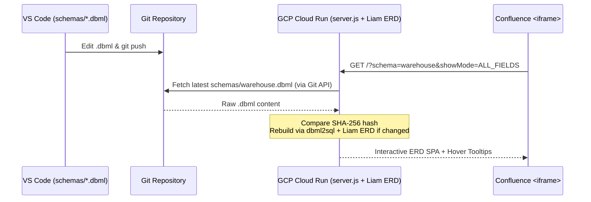

# DB Visualization — Docs-as-Code ERD for Confluence

An automated **Docs-as-Code** workflow for designing, versioning, and visualizing multiple database schemas using **DBML**, **Liam ERD**, **Docker**, and **GCP Cloud Run**, designed to be embedded into **Confluence `<iframe>`** pages.



---

## Tools & Tech Stack

| Tool | License | Commercial Use | Role in Project |
| :--- | :--- | :--- | :--- |
| **[DBML Specification](https://dbml.dbdiagram.io/)** | **Apache-2.0** | ✅ Free | Declarative, human-readable DSL for defining database tables, columns, enums, relationships, indexes, table groups, and documentation notes (`schemas/*.dbml`). |
| **[`@dbml/cli` (`dbml2sql`)](https://github.com/holistics/dbml)** | **Apache-2.0** | ✅ Free | Open-source CLI that converts `.dbml` files into PostgreSQL DDL (`CREATE TABLE`, `ALTER TABLE ... ADD FOREIGN KEY`, `COMMENT ON TABLE`, `COMMENT ON COLUMN`). |
| **[Liam ERD (`@liam-hq/cli`)](https://github.com/liam-hq/liam)** | **Apache-2.0** | ✅ Free | Open-source generator that builds an interactive web-based Entity-Relationship Diagram (SPA) from the generated PostgreSQL DDL, featuring panning, zooming, search, relationship highlighting, and field filtering. |
| **[Node.js 22 (`node:22-alpine`)](https://nodejs.org/)** | **MIT** | ✅ Free | Runtime for `cloud_function/server.js` — a zero-dependency HTTP server that dynamically fetches `.dbml` files from Git, caches builds by SHA-256 hash, isolates multiple schemas across Confluence `<iframe>` embeds, and injects hover tooltips. |
| **VS Code Extensions** (`bocovo.dbml-erd-visualizer`, `matt-meyers.vscode-dbml`) | **MIT** | ✅ Free | Local IDE syntax highlighting and live DBML diagram preview during schema authoring. |
| **Docker Engine / CLI & Buildx** | **Apache-2.0** | ✅ Free* | Container build and runtime tools (*see note below on Docker Desktop vs. open-source runtimes*). |
| **GCP Cloud Run & Cloud Build** | **Cloud Service (Pay-as-you-go)** | ✅ Free Tier / Paid | Serverless container runtime providing an HTTPS endpoint (`https://*.a.run.app`) that scales to zero when idle. |

### Licensing & Commercial Compliance Notes

* **No Paid SaaS Subscriptions Required for Diagramming:** Unlike hosted `dbdiagram.io` or `dbdocs.io` (which require paid per-user subscriptions for private schemas, table groups, or password protection), both **`@dbml/cli`** and **`@liam-hq/cli`** are licensed under the permissive **Apache-2.0 License**. They can be freely used, modified, and self-hosted inside commercial/enterprise environments without licensing fees.
* **Docker Licensing Note:**
  * **Docker Engine, Docker CLI, and Buildx** are open-source under **Apache-2.0** and completely free for any company size when used on Linux, in CI/CD, or on macOS via open-source runtimes like **Colima** or **Rancher Desktop**.
  * **Docker Desktop** (the GUI application) requires a paid subscription for organizations with more than 250 employees or more than \$10M in annual revenue.
* **Google Cloud Platform (GCP) Costs:**
  * **Cloud Run** includes an Always Free tier (2 million requests/month, 360,000 GB-seconds of memory, and 180,000 vCPU-seconds/month). Because the service scales down to `0` instances when nobody is viewing a Confluence page, internal team usage typically stays at **\$0.00/month**.
  * **Cloud Build** includes 120 free build-minutes per day.

---

## Project Structure

```text
db_visualisation/
├── schemas/
│   ├── e_shop_schema.dbml       # E-Commerce database schema
│   └── warehouse.dbml           # Warehouse Management System (WMS) schema
├── cloud_function/
│   ├── docker/
│   │   └── Dockerfile           # Production & local Docker image definition
│   └── server.js                # Dynamic multi-schema build & static server
├── .dockerignore
└── README.md
```

---

## Local Usage (VS Code + Docker)

### 1. Recommended VS Code Extensions
For syntax highlighting and side-by-side preview while editing `.dbml` files in VS Code:
* **DBML Entity-Relationship Diagrams visualizer** (`bocovo.dbml-erd-visualizer`)
* **vscode-dbml** (`matt-meyers.vscode-dbml`)

### 2. Build the Docker Image
From the project root directory:

```bash
docker build -f cloud_function/docker/Dockerfile -t erd-liam .
```

> **Note for macOS (Homebrew Docker CLI):** If you see `DEPRECATED: The legacy builder is deprecated`, enable Docker Buildx:
> ```bash
> brew install docker-buildx
> mkdir -p ~/.docker/cli-plugins
> ln -sfn "$(brew --prefix)/opt/docker-buildx/bin/docker-buildx" ~/.docker/cli-plugins/docker-buildx
> ```

### 3. Run Locally with Live Reload on Refresh
Mount the local `schemas/` folder and `server.js` into the container so any edits saved in VS Code (`Cmd + S`) take effect immediately when you refresh the browser (no container restart needed):

```bash
docker run --rm -p 3002:8080 \
  -v "$(pwd)/schemas:/app/schemas:ro" \
  -v "$(pwd)/cloud_function/server.js:/app/cloud_function/server.js:ro" \
  erd-liam
```

### 4. Open in Browser
* **Schema Directory (lists all `.dbml` files with copyable Confluence URLs):**
  [http://localhost:3002/](http://localhost:3002/)
* **E-Shop Schema:**
  [http://localhost:3002/?schema=e_shop_schema&showMode=ALL_FIELDS](http://localhost:3002/?schema=e_shop_schema&showMode=ALL_FIELDS)
* **Warehouse Schema:**
  [http://localhost:3002/?schema=warehouse&showMode=ALL_FIELDS](http://localhost:3002/?schema=warehouse&showMode=ALL_FIELDS)
* **Build Status & Diagnostics API:**
  [http://localhost:3002/api/status](http://localhost:3002/api/status)

---

## Writing Schemas & Documentation Notes

1. **Adding a New Schema:**
   Create a new `<name>.dbml` file inside the `schemas/` folder (e.g., `schemas/crm.dbml`). It will automatically appear on the root directory page (`/`) and be accessible at `/?schema=crm&showMode=ALL_FIELDS`.
2. **Adding Table & Field Descriptions:**
   Use `note: '...'` on columns and `Note: '...'` inside tables:
   ```dbml
   Table warehouses {
     id integer [pk, increment, note: 'Primary warehouse identifier']
     code varchar(20) [unique, not null, note: 'Short facility code, e.g., WH-LWO-01']

     Note: 'Physical warehouse facilities and distribution centers'
   }
   ```
   Descriptions are visible both **on mouse hover (tooltip)** directly on the diagram canvas and **in the right-hand details panel** when clicking a table.

---

## Deploying to GCP Cloud Run

Because the server dynamically fetches `.dbml` files from your Git repository on the fly, **you only need to deploy the service to GCP Cloud Run once**. Subsequent changes pushed to `schemas/*.dbml` in Git will automatically render in Confluence without redeploying the container.

### Step 1. Build and Push the Image with Cloud Build
Run from the project root directory (replace `YOUR_GCP_PROJECT_ID` and `YOUR_REGION`, e.g., `europe-west1`):

```bash
gcloud builds submit \
  --config /dev/stdin \
  --substitutions=_IMAGE="gcr.io/YOUR_GCP_PROJECT_ID/erd-liam:latest" . <<EOF
steps:
  - name: 'gcr.io/cloud-builders/docker'
    args: ['build', '-f', 'cloud_function/docker/Dockerfile', '-t', '\${_IMAGE}', '.']
images:
  - '\${_IMAGE}'
EOF
```

### Step 2. Deploy the Cloud Run Service

#### Option A: Connect to a GitHub Repository
```bash
gcloud run deploy erd-liam \
  --image gcr.io/YOUR_GCP_PROJECT_ID/erd-liam:latest \
  --region europe-west1 \
  --platform managed \
  --allow-unauthenticated \
  --memory 512Mi \
  --set-env-vars="GITHUB_REPO=YOUR_ORG/YOUR_REPO,GIT_BRANCH=main,SCHEMAS_DIR=schemas,GIT_TOKEN=ghp_YOUR_GITHUB_PAT,ACCESS_KEY=YOUR_CONFLUENCE_SECRET_KEY"
```

#### Option B: Connect to a GitLab Repository
```bash
gcloud run deploy erd-liam \
  --image gcr.io/YOUR_GCP_PROJECT_ID/erd-liam:latest \
  --region europe-west1 \
  --platform managed \
  --allow-unauthenticated \
  --memory 512Mi \
  --set-env-vars="GITLAB_PROJECT_ID=YOUR_PROJECT_ID,GIT_BRANCH=main,SCHEMAS_DIR=schemas,GIT_TOKEN=glpat_YOUR_GITLAB_PAT,ACCESS_KEY=YOUR_CONFLUENCE_SECRET_KEY"
```

---

## Environment Variables Reference

| Variable | Default | Description |
| :--- | :--- | :--- |
| `PORT` | `8080` | HTTP port listened on by `server.js`. |
| `SCHEMAS_DIR` | `schemas` | Folder path in the repository containing `.dbml` files. |
| `GITHUB_REPO` | `""` | GitHub repository in `owner/repo` format for dynamic fetching. |
| `GITLAB_PROJECT_ID` | `""` | GitLab project ID or URL-encoded path (`group/project`). |
| `GITLAB_URL` | `https://gitlab.com` | Base URL for self-hosted or cloud GitLab instances. |
| `GIT_RAW_URL` | `""` | Custom raw file URL template supporting `{branch}` and `{file}` placeholders. |
| `GIT_TOKEN` | `""` | Personal Access Token (GitHub PAT or GitLab Token) with read access to repository contents. |
| `GIT_BRANCH` | `main` | Default Git branch to read schemas from when `?branch=` is not specified in the URL. |
| `DEFAULT_SCHEMA` | `""` | Optional default schema name. When empty, `/` displays the interactive schema directory. |
| `CACHE_TTL_SECONDS` | `15` | Seconds to cache remote Git checks before polling Git API again. |
| `ACCESS_KEY` | `""` | Optional shared secret required in `?key=...` to prevent unauthorized access outside Confluence. |
| `FRAME_ANCESTORS` | `'self' https://*.atlassian.net` | Allowed parent domains in the `Content-Security-Policy: frame-ancestors` header. |

---

## Embedding in Confluence `<iframe>`

1. Open your target Confluence page and insert the **Iframe** macro.
2. Configure the macro URL for the specific schema you want to display on that page:
   * **E-Shop Page:**
     ```text
     https://erd-liam-xxxxx-ew.a.run.app/?schema=e_shop_schema&showMode=ALL_FIELDS&key=YOUR_CONFLUENCE_SECRET_KEY
     ```
   * **Warehouse Page:**
     ```text
     https://erd-liam-xxxxx-ew.a.run.app/?schema=warehouse&showMode=ALL_FIELDS&key=YOUR_CONFLUENCE_SECRET_KEY
     ```
   * **Specific Feature Branch (e.g., for RFC / Architecture Review pages):**
     ```text
     https://erd-liam-xxxxx-ew.a.run.app/?schema=warehouse&branch=feat/new-lots&showMode=ALL_FIELDS&key=YOUR_CONFLUENCE_SECRET_KEY
     ```
3. Set **Width** to `100%` and **Height** to `800px`.

