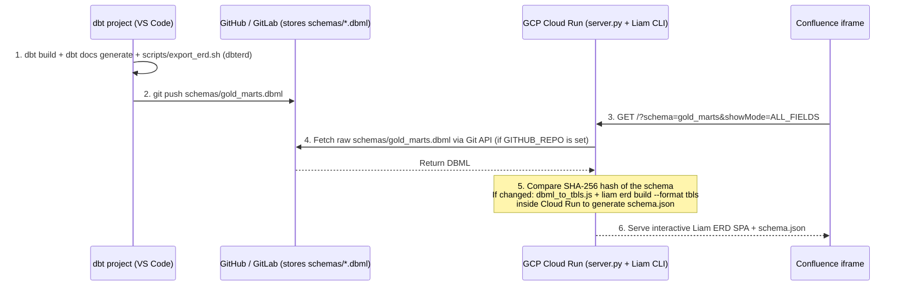

# DB Visualization — Docs-as-Code ERD for Confluence

An automated **Docs-as-Code** workflow that models data in **dbt**, exports the models as **DBML** schemas with **dbterd**, and visualizes them as interactive **Liam ERD** diagrams. The diagrams are served by **Docker** / **GCP Cloud Run** and designed to be embedded into **Confluence `<iframe>`** pages.



---

## Tools & Tech Stack

| Tool | License | Commercial Use | Role in Project |
| :--- | :--- | :--- | :--- |
| **[dbt Core](https://github.com/dbt-labs/dbt-core) + [dbt-duckdb](https://github.com/duckdb/dbt-duckdb)** | **Apache-2.0 / MIT** | ✅ Free | Source of truth for the data models (`dbt_medallion/`): SQL models, YAML docs and tests. `dbt docs generate` produces the `manifest.json` / `catalog.json` that the exporter reads. |
| **[dbterd](https://github.com/datnguye/dbterd)** | **MIT** | ✅ Free | Generates the DBML schemas (`schemas/*.dbml`) from the dbt artifacts, using the model contract constraints for primary keys and relationships. Run by `dbt_medallion/scripts/export_erd.sh`. |
| **[DBML (`@dbml/core`)](https://github.com/holistics/dbml)** | **Apache-2.0** | ✅ Free | Schema format stored in Git. `cloud_function/dbml_to_tbls.js` parses it with `@dbml/core` and converts it to tbls JSON for Liam. |
| **[tbls JSON format](https://github.com/k1LoW/tbls)** | **MIT** | ✅ Free | Intermediate format (tables, typed columns, comments, constraints and relations) that Liam reads with `--format tbls`. Generated inside the container, never committed. |
| **[Liam ERD (`@liam-hq/cli`)](https://github.com/liam-hq/liam)** | **Apache-2.0** | ✅ Free | Open-source generator that builds an interactive web-based Entity-Relationship Diagram (SPA) from the tbls JSON schema. |
| **[Python 3](https://www.python.org/) + [FastAPI](https://fastapi.tiangolo.com/)** | **PSF / MIT** | ✅ Free | Asynchronous Python web framework (`cloud_function/server.py`) powered by **Uvicorn** (BSD-3-Clause) and **HTTPX** (BSD-3-Clause) that dynamically fetches `.dbml` files from Git, caches builds by SHA-256 hash, isolates multiple schemas across Confluence `<iframe>` embeds, and injects hover tooltips. |
| **[`uv` (`ghcr.io/astral-sh/uv:python3.12-alpine`)](https://docs.astral.sh/uv/)** | **Apache-2.0 / MIT** | ✅ Free | Base container image providing pinned Python 3.12 and high-performance `uv` dependency management (`pyproject.toml` & `uv.lock`) for both the server and the dbt project. |
| **[Node.js (`nodejs` / `npm` on Alpine)](https://nodejs.org/)** | **MIT** | ✅ Free | Runtime inside the container used to execute `dbml_to_tbls.js` and the `@liam-hq/cli` CLI tool. |
| **Docker Engine / CLI & Buildx** | **Apache-2.0** | ✅ Free* | Container build and runtime tools (*see note below on Docker Desktop vs. open-source runtimes*). |
| **GCP Cloud Run & Cloud Build** | **Cloud Service (Pay-as-you-go)** | ✅ Free Tier / Paid | Serverless container runtime providing an HTTPS endpoint (`https://*.a.run.app`) that scales to zero when idle. |

### Licensing & Commercial Compliance Notes

* **No Paid SaaS Subscriptions Required for Diagramming:** Unlike hosted `dbdiagram.io` or `dbdocs.io` (which require paid per-user subscriptions for private schemas or password protection), **dbt Core** and **`@liam-hq/cli`** are licensed under the permissive **Apache-2.0 License**. They can be freely used, modified, and self-hosted inside commercial/enterprise environments without licensing fees.
* **Docker Licensing Note:**
  * **Docker Engine, Docker CLI, and Buildx** are open-source under **Apache-2.0** and completely free for any company size when used on Linux, in CI/CD, or on macOS via open-source runtimes like **Colima** or **Rancher Desktop**.
  * **Docker Desktop** (the GUI application) requires a paid subscription for organizations with more than 250 employees or more than \$10M in annual revenue.
* **Google Cloud Platform (GCP) Costs:**
  * **Cloud Run** includes an Always Free tier (2 million requests/month, 360,000 GB-seconds of memory, and 180,000 vCPU-seconds/month). Because the service scales down to `0` instances when nobody is viewing a Confluence page, internal team usage typically stays at **\$0.00/month**.
  * **Cloud Build** includes 120 free build-minutes per day.

---

## Project Structure

```text
db_visualisation/
├── schemas/                         # Generated by dbt_medallion/scripts/export_erd.sh, do not edit by hand
│   ├── gold_marts.dbml              # Gold dims, facts and cross-domain marts
│   ├── silver_eshop.dbml            # Silver e-shop entities
│   └── silver_warehouse.dbml        # Silver warehouse (WMS) entities
├── cloud_function/
│   ├── docker/
│   │   └── Dockerfile               # Production & local Docker image definition
│   ├── pyproject.toml               # Python project metadata & dependencies (managed by uv)
│   ├── uv.lock                      # Reproducible dependency lockfile
│   ├── dbml_to_tbls.js              # DBML -> tbls JSON converter for Liam ERD
│   └── server.py                    # Async multi-schema FastAPI server
├── dbt_medallion/                   # dbt + DuckDB medallion project (source of truth for the ERDs)
│   ├── seeds/                       # Dummy raw data (one CSV per source table)
│   ├── scripts/export_erd.sh        # dbterd: dbt manifest + catalog -> schemas/*.dbml
│   └── models/{bronze,silver,gold}/
├── .dockerignore
└── README.md
```

---

## dbt Medallion Project (`dbt_medallion/`)

A self-contained dummy **dbt + DuckDB** project that models an e-shop and a warehouse (WMS) system in the medallion (bronze / silver / gold) style. It ships with consistent seed data, so it runs end to end locally without any external database.

```bash
cd dbt_medallion
uv sync
uv run dbt build --profiles-dir .   # seeds + models + tests into medallion.duckdb
```

| Layer | Schema | Materialization | Contents |
| :--- | :--- | :--- | :--- |
| Raw | `raw` | seed | One CSV per source table (`raw_eshop__*`, `raw_wh__*`), typed in `seeds/_seeds.yml` |
| Bronze | `bronze` | view | 1:1 copies of raw tables plus `_loaded_at` / `_source_table`; column descriptions, PK tests |
| Silver | `silver` | table | Renamed, trimmed, normalized entities; enums as `accepted_values` tests, FKs as `relationships` tests; enforced model contracts |
| Gold | `gold` | table | `eshop/`, `warehouse/` dims and facts, plus `cross_domain/` marts; enforced model contracts |

The cross-domain gold models join the two systems on their shared keys:
* `fct_order_fulfillment`: e-shop `orders.order_number` = warehouse `outbound_orders.external_order_ref`. It shows both statuses side by side, lead times, and status inconsistencies.
* `mart_product_stock_reconciliation`: e-shop `products.sku` = warehouse `items.sku`. It compares storefront stock with the warehouse's sellable quantity.

Use `uv run dbt docs generate --profiles-dir . && uv run dbt docs serve --profiles-dir .` to browse the lineage graph.

### Model Contracts (what the diagrams are drawn from)

Silver and gold models have enforced [model contracts](https://docs.getdbt.com/docs/mesh/govern/model-contracts) (`+contract: {enforced: true}` in `dbt_project.yml`). dbterd reads keys and relationships from the contract constraints, not from tests, so every column in a silver or gold YAML needs a `data_type`, and keys are declared as constraints:

```yaml
columns:
  - name: order_id
    data_type: integer
    constraints:
      - type: primary_key            # -> PK on the diagram
    data_tests: [unique, not_null]
  - name: customer_id
    data_type: integer
    constraints:
      - type: foreign_key            # -> relation line to dim_customers
        to: ref('dim_customers')
        to_columns: [customer_id]
    data_tests:
      - not_null
      - relationships:
          arguments:
            to: ref('dim_customers')
            field: customer_id
```

* **dbt enforces the contract at build time.** A model fails if its SQL returns columns or types that differ from the YAML. DuckDB also enforces the primary and foreign keys, so a broken key fails the build, not just a test.
* **Keep the tests.** Many warehouses, Snowflake among them, accept primary and foreign key constraints but don't enforce them, so the `unique`, `not_null` and `relationships` tests are still what checks the data there.
* **One-to-one links:** add `config: {meta: {relationship_type: one-to-one}}` to the foreign key column (see `fct_order_fulfillment.order_id`). Without it, every foreign key is drawn as many-to-one.
* **Self-references can't be drawn.** dbt treats a `foreign_key` constraint that refs its own model as a DAG cycle. So `slv_eshop__categories.parent_category_id` has only its `relationships` test, and that link is missing from `silver_eshop`.

### Exporting ERDs (dbt -> DBML with dbterd)

`scripts/export_erd.sh` runs [dbterd](https://dbterd.datnguyen.de/) with the `model_contract` algorithm. It reads `target/manifest.json` and `target/catalog.json` and writes one `schemas/<name>.dbml` per diagram:

| Schema | dbterd `--select` | Models |
| :--- | :--- | :--- |
| `gold_marts` | `schema:gold` | `models/gold/**` (dims, facts, cross-domain marts) |
| `silver_eshop` | `model.dbt_medallion.slv_eshop__` | `models/silver/eshop/**` |
| `silver_warehouse` | `model.dbt_medallion.slv_wh__` | `models/silver/warehouse/**` |

```bash
cd dbt_medallion
uv run dbt build --profiles-dir .
uv run dbt docs generate --profiles-dir .      # writes target/manifest.json + target/catalog.json
./scripts/export_erd.sh                        # writes all three ../schemas/*.dbml
./scripts/export_erd.sh gold_dims model.dbt_medallion.dim_   # one-off: <name> <dbterd --select>
```

* Column types come from `catalog.json`, and descriptions come from the model YAML docs. Descriptions show as hover tooltips and in the details panel.
* `primary_key` constraints become the table's primary key, and `foreign_key` constraints become relation lines.
* The server converts each DBML file to tbls JSON (`cloud_function/dbml_to_tbls.js`) before running Liam. The relationship type follows the DBML ref:

  | Contract on the FK column | DBML ref | Drawn as |
  | :--- | :--- | :--- |
  | `foreign_key` | `>` | one-to-many |
  | `foreign_key` + `meta.relationship_type: one-to-one` | `-` | one-to-one (the converter adds the `UNIQUE` constraint Liam needs) |

  Many-to-many is modelled as a bridge table with two one-to-many links (e.g. `fct_order_items`).
* dbterd's DBML has no `unique` or `not null` flags, so only primary key columns show as not nullable.

Commit the regenerated `schemas/*.dbml` files so the Cloud Run service can fetch them from Git.

### Updating the Diagrams After dbt Model Changes

The diagrams are drawn from the generated `schemas/*.dbml` files, not from dbt directly. After changing models, regenerate the files and commit them:

```bash
cd dbt_medallion
uv run dbt build --profiles-dir .           # build the changed models (and check their contracts and tests)
uv run dbt docs generate --profiles-dir .   # refresh target/manifest.json + target/catalog.json
./scripts/export_erd.sh                     # rewrite ../schemas/*.dbml
git add ../schemas && git commit -m "Update ERDs"
git push
```

Every kind of model change needs this re-export:

| You changed | What else to update | Shows up on the diagram as |
| :--- | :--- | :--- |
| Columns in the SQL (added, removed, renamed, different type) | The column list and `data_type`s in the YAML, or the contract fails the build | Columns and types |
| YAML `description` | — | Hover tooltips and the details panel |
| `primary_key` / `foreign_key` constraints, `relationship_type` meta | Matching `unique` / `not_null` / `relationships` tests | Primary keys, relation lines, one-to-one vs one-to-many |
| A new model in `models/gold/**` or `models/silver/{eshop,warehouse}/**` | Full contract YAML: every column with a `data_type`, plus its keys | A new table in that diagram, picked up automatically |
| A new layer or folder you want as its own diagram | Add an `export_erd` line to `scripts/export_erd.sh` | A new `schemas/<name>.dbml` |

How the change reaches the viewer:
* **Local container:** started with the `-v` mounts from [Run Locally](#2-run-locally-with-live-reload-on-refresh), it reads `schemas/` straight from disk. Refresh the browser.
* **Cloud Run:** no redeploy is needed. On each request the server fetches the file from Git, compares its SHA-256 hash, and rebuilds the diagram when it has changed. The change can take up to `CACHE_TTL_SECONDS` (15 by default) to appear. Add `&refresh=1` to the URL to force it.
* **Feature branches:** `?branch=feat/my-change` renders the version on that branch, so a model change can be reviewed in Confluence before merging.

#### Do I need to rebuild the Docker image?

Not for model or diagram changes. Rebuild only when the server itself changes:

| What changed | Local container (run with `-v` mounts) | Cloud Run (with `GITHUB_REPO` / `GITLAB_PROJECT_ID` set) |
| :--- | :--- | :--- |
| dbt models, so `schemas/*.dbml` is regenerated | Nothing to do: refresh the browser | Nothing to do: commit and push |
| `cloud_function/server.py` or `cloud_function/dbml_to_tbls.js` | Restart the container (no auto-reload); no rebuild needed | Rebuild the image and redeploy |
| `Dockerfile`, `pyproject.toml` / `uv.lock`, Liam CLI version | Rebuild the image and re-run it | Rebuild the image and redeploy |

You do need a rebuild after model changes in two cases:
* **Local container without the `-v` mounts:** it only has the schemas copied into the image at build time.
* **Cloud Run without Git configured:** with no `GITHUB_REPO`, `GITLAB_PROJECT_ID` or `GIT_RAW_URL` set, the server falls back to those baked-in schemas.

The diagrams built during `docker build` are only a cache. When the file in Git differs from the one baked in, the server builds a fresh diagram the first time someone opens it. That first load takes a few seconds, and later loads are instant until the next change.

#### Keeping diagrams in sync

The diagram goes stale if a model changes and nobody re-exports. To catch this, add a CI step that runs the commands above and fails when `git diff --exit-code -- schemas/` reports changes. With the DuckDB dummy data, this needs no credentials. On a real warehouse (e.g. Snowflake), `dbt docs generate` has to connect to read column types, so the CI job needs database credentials.

---

## Local Usage (Docker)

### 1. Build the Docker Image
From the project root directory:

```bash
docker build -f cloud_function/docker/Dockerfile -t erd-liam .
```

The build pre-renders every `schemas/*.dbml`, so the first page load is instant.

> **Note for macOS (Homebrew Docker CLI):** If you see `DEPRECATED: The legacy builder is deprecated`, enable Docker Buildx:
> ```bash
> brew install docker-buildx
> mkdir -p ~/.docker/cli-plugins
> ln -sfn "$(brew --prefix)/opt/docker-buildx/bin/docker-buildx" ~/.docker/cli-plugins/docker-buildx
> ```

### 2. Run Locally with Live Reload on Refresh
Mount the local `schemas/` folder and `server.py` into the container. Re-running the exporter then takes effect when you refresh the browser, with no container restart needed:

```bash
docker run --rm -p 3002:8080 \
  -v "$(pwd)/schemas:/app/schemas:ro" \
  -v "$(pwd)/cloud_function/server.py:/app/cloud_function/server.py:ro" \
  -v "$(pwd)/cloud_function/dbml_to_tbls.js:/app/cloud_function/dbml_to_tbls.js:ro" \
  erd-liam
```

> **Colima note:** Colima only shares your home directory with Docker by default, so mount folders from inside your home directory (not `/tmp`).

### 3. Open in Browser
* **Schema Directory (lists all `.dbml` files with copyable Confluence URLs):**
  [http://localhost:3002/](http://localhost:3002/)
* **Gold Marts:**
  [http://localhost:3002/?schema=gold_marts&showMode=ALL_FIELDS](http://localhost:3002/?schema=gold_marts&showMode=ALL_FIELDS)
* **Silver E-Shop:**
  [http://localhost:3002/?schema=silver_eshop&showMode=ALL_FIELDS](http://localhost:3002/?schema=silver_eshop&showMode=ALL_FIELDS)
* **Silver Warehouse:**
  [http://localhost:3002/?schema=silver_warehouse&showMode=ALL_FIELDS](http://localhost:3002/?schema=silver_warehouse&showMode=ALL_FIELDS)
* **Build Status & Diagnostics API:**
  [http://localhost:3002/api/status](http://localhost:3002/api/status)

---

## Deploying to GCP Cloud Run (GitHub & GitLab Integration)

Because [`server.py`](cloud_function/server.py) dynamically fetches `.dbml` files from your Git repository on the fly, **you only need to deploy the service to GCP Cloud Run once**. Subsequent changes pushed to `schemas/*.dbml` in Git will automatically render in Confluence without redeploying the container.

### Supported Git Providers

1. **GitLab (GitLab.com & Self-Hosted GitLab Instances):**
   * Uses the official **GitLab REST API v4**:
     * Lists available schemas via `GET {GITLAB_URL}/api/v4/projects/{GITLAB_PROJECT_ID}/repository/tree?path=schemas&ref={branch}`
     * Fetches raw `.dbml` files via `GET {GITLAB_URL}/api/v4/projects/{GITLAB_PROJECT_ID}/repository/files/{file}/raw?ref={branch}`
   * **Token Setup:** In GitLab, navigate to **Settings → Access Tokens** (Project Access Token) or **User Settings → Personal Access Tokens** and create a token with the **`read_api`** (or `read_repository`) scope and **Reporter / Viewer** role.
   * **Project Identifier (`GITLAB_PROJECT_ID`):** Supports either the numeric Project ID (e.g., `5829104`) or the namespace/project path (e.g., `my-group/db-visualisation`).
   * **Self-Hosted GitLab (`GITLAB_URL`):** Defaults to `https://gitlab.com`. Set `GITLAB_URL=https://gitlab.your-company.com` for internal/self-managed GitLab servers.

2. **GitHub (GitHub.com):**
   * Uses the **GitHub REST API v3** (`GET https://api.github.com/repos/{GITHUB_REPO}/contents/{file}?ref={branch}`).
   * **Token Setup:** Create a Fine-Grained Personal Access Token with **Contents: Read-only** permission for your repository.

### Step 1. Build and Push the Image with Cloud Build
Run from the project root directory (replace `YOUR_GCP_PROJECT_ID` and `YOUR_REGION`, e.g., `europe-west1`):

```bash
gcloud builds submit \
  --config /dev/stdin \
  --substitutions=_IMAGE="gcr.io/YOUR_GCP_PROJECT_ID/erd-liam:latest" . <<EOF
steps:
  - name: 'gcr.io/cloud-builders/docker'
    args: ['build', '-f', 'cloud_function/docker/Dockerfile', '-t', '\${_IMAGE}', '.']
images:
  - '\${_IMAGE}'
EOF
```

### Step 2. Deploy the Cloud Run Service

#### Option A: Connect to a GitLab Repository (GitLab.com or Self-Hosted)
```bash
gcloud run deploy erd-liam \
  --image gcr.io/YOUR_GCP_PROJECT_ID/erd-liam:latest \
  --region europe-west1 \
  --platform managed \
  --allow-unauthenticated \
  --memory 512Mi \
  --set-env-vars="GITLAB_PROJECT_ID=my-group/db-visualisation,GITLAB_URL=https://gitlab.com,GIT_BRANCH=main,SCHEMAS_DIR=schemas,GIT_TOKEN=glpat_YOUR_GITLAB_PAT,ACCESS_KEY=YOUR_CONFLUENCE_SECRET_KEY"
```

*(To test GitLab fetching locally with Docker before deploying to GCP):*
```bash
docker run --rm -p 3002:8080 \
  -e GITLAB_PROJECT_ID="my-group/db-visualisation" \
  -e GITLAB_URL="https://gitlab.com" \
  -e GIT_TOKEN="glpat_YOUR_GITLAB_PAT" \
  -e GIT_BRANCH="main" \
  erd-liam
```

#### Option B: Connect to a GitHub Repository
```bash
gcloud run deploy erd-liam \
  --image gcr.io/YOUR_GCP_PROJECT_ID/erd-liam:latest \
  --region europe-west1 \
  --platform managed \
  --allow-unauthenticated \
  --memory 512Mi \
  --set-env-vars="GITHUB_REPO=YOUR_ORG/YOUR_REPO,GIT_BRANCH=main,SCHEMAS_DIR=schemas,GIT_TOKEN=ghp_YOUR_GITHUB_PAT,ACCESS_KEY=YOUR_CONFLUENCE_SECRET_KEY"
```

---

## Environment Variables Reference

| Variable | Default | Description |
| :--- | :--- | :--- |
| `PORT` | `8080` | HTTP port listened on by `server.py`. |
| `SCHEMAS_DIR` | `schemas` | Folder path in the repository containing `.dbml` files. |
| `GITHUB_REPO` | `""` | GitHub repository in `owner/repo` format for dynamic fetching. |
| `GITLAB_PROJECT_ID` | `""` | GitLab project ID or URL-encoded path (`group/project`). |
| `GITLAB_URL` | `https://gitlab.com` | Base URL for self-hosted or cloud GitLab instances. |
| `GIT_RAW_URL` | `""` | Custom raw file URL template supporting `{branch}` and `{file}` placeholders. |
| `GIT_TOKEN` | `""` | Personal Access Token (GitHub PAT or GitLab Token) with read access to repository contents. |
| `GIT_BRANCH` | `main` | Default Git branch to read schemas from when `?branch=` is not specified in the URL. |
| `DEFAULT_SCHEMA` | `""` | Optional default schema name. When empty, `/` displays the interactive schema directory. |
| `CACHE_TTL_SECONDS` | `15` | Seconds to cache remote Git checks before polling Git API again. |
| `ACCESS_KEY` | `""` | Optional shared secret required in `?key=...` to prevent unauthorized access outside Confluence. |
| `FRAME_ANCESTORS` | `'self' https://*.atlassian.net` | Allowed parent domains in the `Content-Security-Policy: frame-ancestors` header. |

---

## Embedding in Confluence `<iframe>`

1. Open your target Confluence page and insert the **Iframe** macro.
2. Configure the macro URL for the specific schema you want to display on that page:
   * **Gold Marts Page:**
     ```text
     https://erd-liam-xxxxx-ew.a.run.app/?schema=gold_marts&showMode=ALL_FIELDS&key=YOUR_CONFLUENCE_SECRET_KEY
     ```
   * **Warehouse Page:**
     ```text
     https://erd-liam-xxxxx-ew.a.run.app/?schema=silver_warehouse&showMode=ALL_FIELDS&key=YOUR_CONFLUENCE_SECRET_KEY
     ```
   * **Specific Feature Branch (e.g., for RFC / Architecture Review pages):**
     ```text
     https://erd-liam-xxxxx-ew.a.run.app/?schema=gold_marts&branch=feat/new-marts&showMode=ALL_FIELDS&key=YOUR_CONFLUENCE_SECRET_KEY
     ```
3. Set **Width** to `100%` and **Height** to `800px`.
